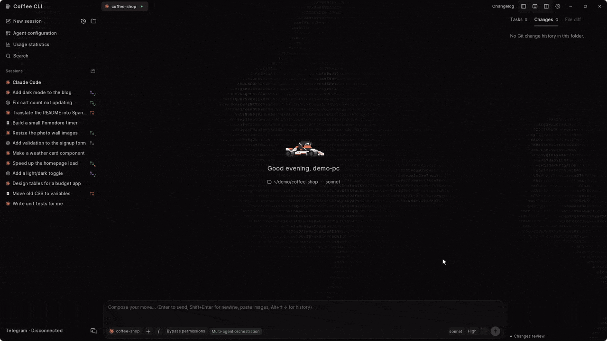
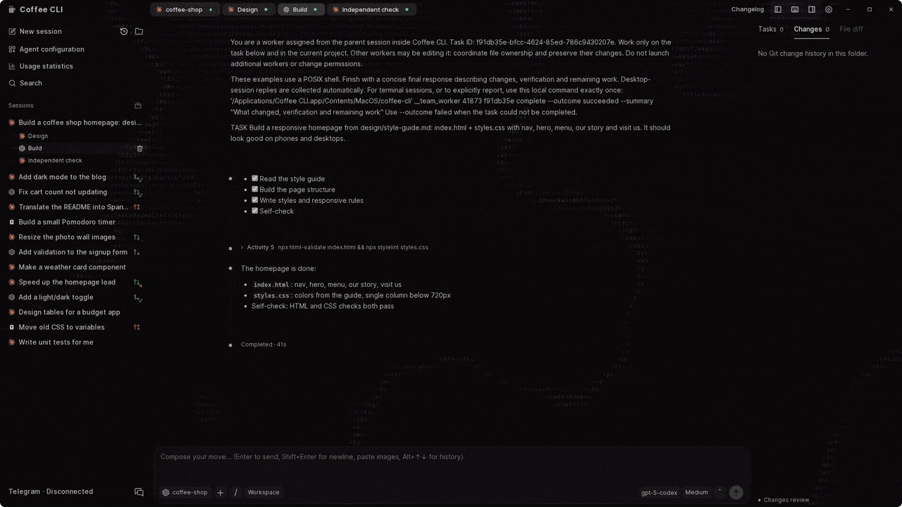

<p align="center">
  
</p>

<h1 align="center">Coffee CLI</h1>

<p align="center">
  <strong>Coffee CLI 区别于其他网红工具，我们不魔改、不反代、不收集和卖数据。</strong><br/>
  <strong>Unlike other hyped tools, Coffee CLI runs your CLIs as-is — no patched builds, no proxy in the middle, and we never collect or sell your data.</strong>
</p>

<p align="center">
  我们会在远程多端、易用性和界面美观上深度创新和优化...<br/>
  We go deep on remote multi-device access, ease of use, and beautiful design...
</p>

<p align="center">
  <a href="#english">English</a> ·
  <a href="#简体中文">简体中文</a> ·
  <a href="#繁體中文">繁體中文</a> ·
  <a href="#deutsch">Deutsch</a> ·
  <a href="#español">Español</a> ·
  <a href="#français">Français</a> ·
  <a href="#日本語">日本語</a> ·
  <a href="#한국어">한국어</a> ·
  <a href="#português">Português</a> ·
  <a href="#русский">Русский</a>
</p>

<p align="center">
  
  
  
</p>

<p align="center">
  
</p>

---

## English

### What is Coffee CLI?

Coffee CLI is a **native desktop workspace** for AI CLI agents — Claude Code, OpenAI Codex, Qwen Code, OpenCode, and more. Use desktop-style conversations or native terminals, run multiple agents in parallel tabs, and drive them with keyboard shortcuts via Gambit — all with a **fully localized interface in 11 languages**.

This is not a web app. Not an Electron wrapper. A **true native desktop app** built with Tauri (Rust core), engineered for performance and low resource usage.

<p align="center">
  
</p>

### Supported AI CLIs

Coffee CLI can launch **any** command-line agent — but the ones below get deeper, purpose-built integration. **T1 supports two modes — a dedicated Desktop conversation and the native Terminal — plus usage statistics.** Lower tiers remain native terminal experiences, with the additional capabilities listed below.

| Tier | What you get | CLIs |
|---|---|---|
| **T1** | **Desktop mode + Terminal mode · Usage statistics** · History · Heatmap · Changes · Brand icon · One-click launch · Custom launch args | **Claude Code** · **DeepSeek Harness** · **Codex CLI** · **OpenCode** · **Pi** · **Antigravity CLI** |
| **T2** | Native terminal · History · Heatmap · Changes · Brand icon · One-click launch · Custom launch args | Kimi Code · mimocode · Grok Build · OpenClaw · Hermes Agent · Qwen Code · Kilo Code · Oh-My-Pi · CodeBuddy |
| **T3** | Brand icon · One-click launch | Crush · Aider · Goose · Copilot CLI · Cursor · Cline · Muse Code |
| **T4** | Open a terminal tab and type the command to launch | any other CLI |

*Desktop mode and usage statistics are currently available for Claude Code, DeepSeek Harness, Codex CLI, OpenCode, Pi, and Antigravity CLI. Other tools stay in their native terminal UI even when Coffee CLI can read their history.*

*T1 and T2 CLIs ship today; T3 integrations are rolling in.*

Muse Code launches `muse` in your selected directory. Its session history and heatmap are not integrated into Coffee CLI yet.

Antigravity IDE mode uses the official `agy acp` interface for model, thinking-level and permission controls, streamed tool calls, cancellation and history restoration. See [Google's ACP documentation](https://antigravity.google/docs/ide/extensions/acp/).

### Desktop & Terminal Modes

**Claude Code and Codex CLI** offer `Desktop / Terminal` tabs on their launch cards. Desktop is the default for new installations; saved preferences are preserved. Desktop mode displays conversations, tool activity, permission/input cards, and conversation navigation while staying connected to the native background session. Coffee Agent can read and operate that same desktop-mode session without opening a separate terminal.

---

### Who is it for?

AI coding agents are transforming how work gets done — but they speak English, output dense terminal text, and assume you're comfortable with a command line. That leaves out a massive group of capable, intelligent professionals:

- **Business executives** who want AI to accelerate decisions and automate operations
- **Designers and creatives** who want to build and automate without learning bash
- **Product managers** who want to run agents against their own products
- **Researchers, analysts, consultants** — any domain expert who isn't a developer

Coffee CLI removes both barriers at once: **no terminal expertise required, no English required**.

---

### See It In Action

#### Theme Switching

Coffee CLI ships with multiple built-in themes. Switch between them instantly — the entire interface, including the active terminal session, updates live. No restart, no flicker. Whether you prefer a dark workspace late at night or a lighter tone during a presentation, one click is all it takes.

---

#### Task Board

Your agent works fast. Keep up with it. The built-in task board lets you create and organize tasks into **To-Do / In Progress / Done** columns — right in the sidebar while the agent runs. No external tool, no tab switching. Everything the agent is doing and everything you still need it to do, visible at a glance.

---

#### Session History

Every conversation with every agent is automatically saved. The **History panel** gives you a full searchable log of past sessions — scroll back through what was said, what was built, what went wrong. Pick up any past session exactly where you left off, or use it as context for a new one.

---

#### 11-Language Interface

The Coffee CLI app ships with a fully localized UI in 11 languages — menus, dialogs, shortcuts, and every corner of the workspace speak English, 简体中文, 繁體中文, 日本語, 한국어, Español, Français, Deutsch, Português, Русский, or Tiếng Việt. Switch anytime from the settings.

---

### Key Features

| Feature | Description |
|---|---|
| **Desktop Conversations** | Claude Code and Codex CLI support Desktop or Terminal launch modes, with native background sessions and same-session Coffee Agent control |
| **Multi-Tab Sessions** | Run multiple agents side by side, each with its own independent process and context |
| **Session History** | Every session auto-saved and searchable; resume any conversation from where you left off |
| **Built-In File Explorer** | Browse your workspace, copy paths, drag references directly into your prompt |
| **Task Board** | Organize what you've asked the agent to do across To-Do / In Progress / Done |
| **Agent Installer** | One-click install of Claude Code, Codex, and more — no terminal required |
| **Remote Terminal** | SSH into remote machines and run agents on servers without leaving the app |
| **External Launch** | Open the app straight into a fresh agent tab at a chosen folder from scripts, launchers, and file-manager context menus |
| **Hook Compatibility** | Hook-free status detection; existing user and third-party status hooks and hook plugins are preserved |

**11 languages supported out of the box:** English · 简体中文 · 繁體中文 · Deutsch · Español · Français · 日本語 · 한국어 · Português · Русский · Tiếng Việt

**Hook policy:** Startup and tool scans do not install, migrate, or remove status hooks or hook plugins. Existing user hooks, third-party integrations, and hooks left by older Coffee CLI versions remain untouched.

### External Launch (CLI)

`coffee-cli launch --tool <id> [--cwd <dir>]` skips the launchpad and drops
you straight into a new agent tab — for launcher apps, context menus,
Raycast/Alfred actions, and shell aliases. `--tool` is any registered tool
id (`claude`, `codex`, `kimicode`, `hermes`, …); omit `--cwd` to reuse the
tool's last folder. Already running? The request is forwarded to the
running instance and opens a new tab — existing sessions are never
restarted or hijacked.

```bash
# macOS — call the binary directly (LaunchServices drops --args when the app is already running)
"/Applications/Coffee CLI.app/Contents/MacOS/coffee-cli" launch --tool kimicode --cwd /work/project
# Windows — pair with an Explorer right-click entry that passes the folder as %V
coffee-cli.exe launch --tool claude --cwd "C:\work\project"
# Linux
coffee-cli launch --tool codex --cwd ~/work/project
```

---

### Install

**Windows**
```powershell
irm https://raw.githubusercontent.com/edison7009/Coffee-CLI/main/install/install.ps1 | iex
```

**macOS** (Apple Silicon & Intel)
```bash
curl -fsSL https://raw.githubusercontent.com/edison7009/Coffee-CLI/main/install/install.sh | sh
```

**Linux** (Debian / Ubuntu / AppImage)
```bash
curl -fsSL https://raw.githubusercontent.com/edison7009/Coffee-CLI/main/install/install.sh | sh
```

Or download directly from [Releases](https://github.com/edison7009/Coffee-CLI/releases).

| Platform | Installer |
|---|---|
| Windows x64 | `.exe` setup |
| macOS Apple Silicon (M1+) | `.dmg` |
| Linux Debian/Ubuntu | `.deb` |
| Linux universal | `.AppImage` |

---

## 简体中文

### Coffee CLI 是什么？

Coffee CLI 是专为 AI CLI Agent 打造的**原生桌面工作台**，支持 Claude Code、OpenAI Codex、Qwen Code、OpenCode 等主流 Agent。桌面式对话与原生终端、多 Tab 并行运行、Gambit 快捷操控——所有 AI CLI 工具在一个真正的桌面应用里井然有序，**原生支持 11 种界面语言**。

这不是网页应用，不是 Electron 壳，而是基于 Tauri（Rust 内核）构建的**真正原生桌面应用**，性能优异，资源占用极低。

### AI CLI 支持级别

**T1 支持桌面式与终端式两种模式，并提供用量统计**，目前包括 **Claude Code、DeepSeek Harness、Codex CLI、OpenCode、Pi 和 Antigravity CLI** 共 6 个。Kimi Code、mimocode、Grok Build 等其他工具保持原生终端界面；可读取历史记录不代表支持桌面式模式。

Muse Code 目前支持在所选目录启动 `muse`，暂未接入 Coffee CLI 的会话记录和热力图。

### 桌面式与终端式

**Claude Code 和 Codex CLI** 的启动卡片提供 `Desktop / Terminal` 切换。新安装默认使用 Desktop，已有用户的选择会保留。桌面式支持对话、工具执行、权限/输入卡片和对话导航，并持续连接原生后台会话。Coffee Agent 也能读取和操作同一个桌面式后台会话，无需另开终端。

### 为谁而生？

AI 编程 Agent 正在改变工作方式——但它们说英语、输出密集的终端文本，默认你熟悉命令行。这将大量有能力、有智识的专业人士拒之门外：

- **企业高管**：想用 AI 加速决策、自动化业务流程
- **设计师与创意人**：想构建和自动化，但不想学 bash
- **产品经理**：想直接对自己的产品跑 Agent
- **研究员、分析师、顾问**：各行各业的领域专家，不是开发者

Coffee CLI 同时消除两道门槛：**不需要终端经验，不需要懂英语**。

### 核心功能

**桌面式对话** · **多 Tab 会话** · **Gambit 快捷命令** · **会话历史** · **内置文件浏览器** · **任务板** · **Agent 安装器** · **远程终端** · **外部唤起** · **Hook 配置保留**

原生支持 11 种语言，开箱即用。

**Hook 兼容策略：** Coffee CLI 的状态识别不依赖 Hook。启动与工具扫描时不会安装、迁移或清理状态 Hook 及相关插件；用户已有配置、第三方工具写入的 Hook，以及旧版 Coffee CLI 留下的 Hook 均保持原样。

### 外部唤起（命令行）

`coffee-cli launch --tool <id> [--cwd <dir>]` 跳过启动台，直接新开一个指定 Agent、指定目录的标签页——适合启动器、资源管理器右键菜单、Raycast/Alfred、脚本别名。`--tool` 取注册表中的 id（`claude`、`codex`、`kimicode`、`hermes`……）；省略 `--cwd` 时沿用该工具上次使用的目录。应用已在运行时，请求会转发给运行中的实例新开标签页，不影响已有会话。

```bash
# macOS —— 建议直接调用二进制（应用已运行时，open -a 的 --args 会被系统丢弃）
"/Applications/Coffee CLI.app/Contents/MacOS/coffee-cli" launch --tool kimicode --cwd /work/project
# Windows —— 配合资源管理器右键菜单，用 %V 传入当前文件夹
coffee-cli.exe launch --tool claude --cwd "C:\work\project"
# Linux
coffee-cli launch --tool codex --cwd ~/work/project
```

### 安装

**Windows**
```powershell
irm https://raw.githubusercontent.com/edison7009/Coffee-CLI/main/install/install.ps1 | iex
```

**macOS / Linux**
```bash
curl -fsSL https://raw.githubusercontent.com/edison7009/Coffee-CLI/main/install/install.sh | sh
```

也可以直接从 [Releases](https://github.com/edison7009/Coffee-CLI/releases) 下载对应平台的安装包。

---

## 繁體中文

### Coffee CLI 是什麼？

Coffee CLI 是專為 AI CLI Agent 打造的**原生桌面伴侶應用**，支援 Claude Code、OpenAI Codex 等主流 Agent。它將終端包裝進完整的圖形介面，並實現了其他任何工具都沒有的功能：**將整個 CLI Agent 介面即時翻譯成你的母語**。

這不是網頁應用，不是 Electron 殼，而是基於 Tauri（Rust 核心）構建的**真正原生桌面應用**，效能優異，資源佔用極低。

Coffee CLI 同時消除兩道門檻：**不需要終端經驗，不需要懂英語**。

Claude Code 與 Codex CLI 支援 `Desktop / Terminal` 兩種啟動方式。既有的使用者、第三方與舊版 Coffee CLI 狀態 Hook 及相關外掛會原樣保留，不會安裝、遷移或清理。

**核心功能：** 即時終端翻譯 · 多 Tab 會話 · 會話歷史 · 內建檔案瀏覽器 · 任務板 · Agent 安裝器 · 遠端終端

原生支援 11 種語言，開箱即用。

---

## Deutsch

### Was ist Coffee CLI?

Coffee CLI ist eine **native Desktop-Begleit-App** für KI-CLI-Agenten — Claude Code, OpenAI Codex und mehr. Es bettet Ihr Terminal in eine vollständige GUI ein und tut etwas, das kein anderes Tool leistet: Es **übersetzt die gesamte CLI-Agent-Oberfläche in Ihre Muttersprache, in Echtzeit**.

Keine Web-App. Kein Electron-Wrapper. Eine **echte native Desktop-Anwendung**, gebaut mit Tauri (Rust-Kern).

Coffee CLI beseitigt beide Hürden gleichzeitig: **Keine Terminal-Kenntnisse erforderlich, kein Englisch erforderlich.**

Claude Code und Codex CLI unterstützen die Startmodi `Desktop / Terminal`. Bestehende Status-Hooks und Hook-Plugins von Nutzern, Drittanbietern und älteren Coffee-CLI-Versionen bleiben erhalten; sie werden weder installiert noch migriert oder entfernt.

**Hauptfunktionen:** Echtzeit-Terminal-Übersetzung · Multi-Tab-Sitzungen · Sitzungsverlauf · Datei-Explorer · Aufgaben-Board · Agent-Installer · Remote-Terminal

11 Sprachen werden nativ unterstützt.

---

## Español

### ¿Qué es Coffee CLI?

Coffee CLI es una **aplicación de escritorio nativa** diseñada para agentes de IA en CLI — Claude Code, OpenAI Codex y más. Envuelve tu terminal en una interfaz gráfica completa y hace algo que ninguna otra herramienta hace: **traduce toda la interfaz del agente CLI a tu idioma nativo, en tiempo real**.

No es una aplicación web. No es un envoltorio de Electron. Es una **aplicación de escritorio nativa real**, construida con Tauri (núcleo en Rust).

Coffee CLI elimina ambas barreras a la vez: **sin necesidad de experiencia en terminal, sin necesidad de saber inglés.**

Claude Code y Codex CLI admiten los modos `Desktop / Terminal`. Se conservan los hooks de estado y sus plugins existentes, incluidos los del usuario, de terceros y de versiones anteriores de Coffee CLI; no se instalan, migran ni eliminan.

**Funciones principales:** Traducción de terminal en tiempo real · Sesiones multi-pestaña · Historial de sesiones · Explorador de archivos · Tablero de tareas · Instalador de agentes · Terminal remota

10 idiomas compatibles de serie.

---

## Français

### Qu'est-ce que Coffee CLI ?

Coffee CLI est une **application de bureau native** conçue pour les agents IA en ligne de commande — Claude Code, OpenAI Codex et autres. Elle enveloppe votre terminal dans une interface graphique complète et fait quelque chose qu'aucun autre outil ne fait : **elle traduit toute l'interface de l'agent CLI dans votre langue maternelle, en temps réel**.

Ce n'est pas une application web. Pas un wrapper Electron. Une **vraie application de bureau native**, construite avec Tauri (cœur Rust).

Coffee CLI supprime les deux barrières à la fois : **aucune expertise terminal requise, aucune connaissance de l'anglais requise.**

Claude Code et Codex CLI proposent les modes `Desktop / Terminal`. Les hooks de statut et leurs plugins existants, qu’ils proviennent de l’utilisateur, de tiers ou d’anciennes versions de Coffee CLI, sont conservés ; ils ne sont ni installés, ni migrés, ni supprimés.

**Fonctionnalités clés :** Traduction de terminal en temps réel · Sessions multi-onglets · Historique des sessions · Explorateur de fichiers · Tableau de tâches · Installeur d'agents · Terminal distant

10 langues prises en charge nativement.

---

## 日本語

### Coffee CLI とは？

Coffee CLI は、AI CLI エージェント（Claude Code、OpenAI Codex など）向けに作られた**ネイティブデスクトップコンパニオンアプリ**です。ターミナルを完全な GUI でラップし、他のどのツールも実現していない機能を提供します：**CLI エージェントのインターフェース全体をリアルタイムであなたの母国語に翻訳する**機能です。

ウェブアプリでも Electron ラッパーでもありません。Tauri（Rust コア）で構築された**真のネイティブデスクトップアプリ**です。

Coffee CLI はその2つのハードルを同時に取り除きます：**ターミナルの知識不要、英語不要**。

Claude Code と Codex CLI は `Desktop / Terminal` の両モードに対応しています。ユーザー、サードパーティー、旧バージョンの Coffee CLI による既存のステータス Hook と関連プラグインはそのまま保持し、インストール・移行・削除は行いません。

**主な機能：** リアルタイム翻訳 · マルチタブセッション · セッション履歴 · ファイルエクスプローラー · タスクボード · エージェントインストーラー · リモートターミナル

11言語をネイティブサポート。

---

## 한국어

### Coffee CLI란?

Coffee CLI는 AI CLI 에이전트(Claude Code, OpenAI Codex 등)를 위한 **네이티브 데스크톱 컴패니언 앱**입니다. 터미널을 완전한 GUI로 감싸고, 다른 어떤 도구도 하지 못하는 기능을 제공합니다: **CLI 에이전트 인터페이스 전체를 실시간으로 모국어로 번역**합니다.

웹 앱도 아니고 Electron 래퍼도 아닙니다. Tauri(Rust 코어)로 구축된 **진정한 네이티브 데스크톱 앱**입니다.

Coffee CLI는 두 가지 장벽을 동시에 제거합니다: **터미널 지식 불필요, 영어 불필요**.

Claude Code와 Codex CLI는 `Desktop / Terminal` 실행 모드를 지원합니다. 사용자, 타사 도구 및 이전 Coffee CLI 버전의 기존 상태 Hook과 관련 플러그인은 그대로 보존하며 설치, 이전 또는 삭제하지 않습니다.

**주요 기능:** 실시간 번역 · 멀티탭 세션 · 세션 히스토리 · 파일 탐색기 · 작업 보드 · 에이전트 설치 관리자 · 원격 터미널

11개 언어 기본 지원.

---

## Português

### O que é o Coffee CLI?

Coffee CLI é um **aplicativo de desktop nativo** projetado para agentes de IA em CLI — Claude Code, OpenAI Codex e outros. Ele envolve seu terminal em uma interface gráfica completa e faz algo que nenhuma outra ferramenta faz: **traduz toda a interface do agente CLI para seu idioma nativo, em tempo real**.

Não é um aplicativo web. Não é um wrapper Electron. É um **verdadeiro aplicativo de desktop nativo**, construído com Tauri (núcleo em Rust).

Coffee CLI elimina as duas barreiras ao mesmo tempo: **sem necessidade de experiência em terminal, sem necessidade de saber inglês.**

Claude Code e Codex CLI oferecem os modos `Desktop / Terminal`. Os hooks de estado e plugins existentes do utilizador, de terceiros e de versões anteriores do Coffee CLI são preservados, sem instalação, migração ou remoção.

**Recursos principais:** Tradução de terminal em tempo real · Sessões multi-aba · Histórico de sessões · Explorador de arquivos · Quadro de tarefas · Instalador de agentes · Terminal remoto

10 idiomas suportados nativamente.

---

## Русский

### Что такое Coffee CLI?

Coffee CLI — это **нативное десктопное приложение-компаньон** для ИИ-агентов в CLI — Claude Code, OpenAI Codex и других. Оно оборачивает терминал в полноценный графический интерфейс и делает то, чего не умеет ни один другой инструмент: **переводит весь интерфейс CLI-агента на ваш родной язык в реальном времени**.

Это не веб-приложение. Не обёртка на Electron. Настоящее **нативное десктопное приложение**, построенное на Tauri (ядро на Rust).

Coffee CLI устраняет оба барьера одновременно: **не нужно знать терминал, не нужно знать английский**.

Claude Code и Codex CLI поддерживают режимы `Desktop / Terminal`. Существующие хуки состояния и связанные плагины пользователя, сторонних инструментов и прежних версий Coffee CLI сохраняются без установки, переноса или удаления.

**Ключевые функции:** Перевод терминала в реальном времени · Мультивкладочные сессии · История сессий · Файловый проводник · Доска задач · Установщик агентов · Удалённый терминал

11 языков поддерживается нативно.

---

## License & Trademarks

As part of our evolving product strategy and development roadmap, certain non-core features of our existing product will be
gradually separated and developed into independent products.

To protect innovation and maintain the market competitiveness of our new products, we have temporarily restricted
public access to the existing product's source code, while keeping user feedback channels open. Releases up to and including
v4.1.1 remain available under [AGPL-3.0](https://github.com/edison7009/Coffee-CLI/blob/v4.1.1/LICENSE).

*Coffee CLI* and its related product names are trademarks of edison7009 — see [TRADEMARKS.md](TRADEMARKS.md).
The product is provided as is, without warranty. For business and enterprise partnerships, contact
**hi@coffeecli.com**; feedback is always welcome through [Issues](https://github.com/edison7009/Coffee-CLI/issues).

Thank you for your continued support and understanding.

---

## 协议与商标

因产品战略与发展规划调整，现有产品的部分非核心功能将逐步剥离，并作为独立的新产品进行开发与运营。

同时，为保护新产品的创新成果并保持市场竞争力，现有产品将暂时停止公开源代码，仅保留用户反馈渠道。v4.1.1 及之前的版本仍按
[AGPL-3.0](https://github.com/edison7009/Coffee-CLI/blob/v4.1.1/LICENSE) 提供。

*Coffee CLI* 及相关产品名称为 edison7009 的商标，详见 [TRADEMARKS.md](TRADEMARKS.md)。本产品按现状提供，不作任何担保。
商务与企业合作请联系 **hi@coffeecli.com**，问题反馈欢迎提交 [Issue](https://github.com/edison7009/Coffee-CLI/issues)。

感谢大家一直以来的关注与支持。

---

Copyright © 2024-2026 [edison7009](https://github.com/edison7009) and Coffee CLI contributors.
